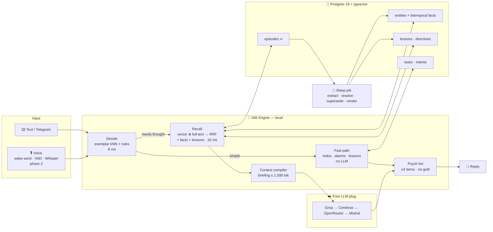
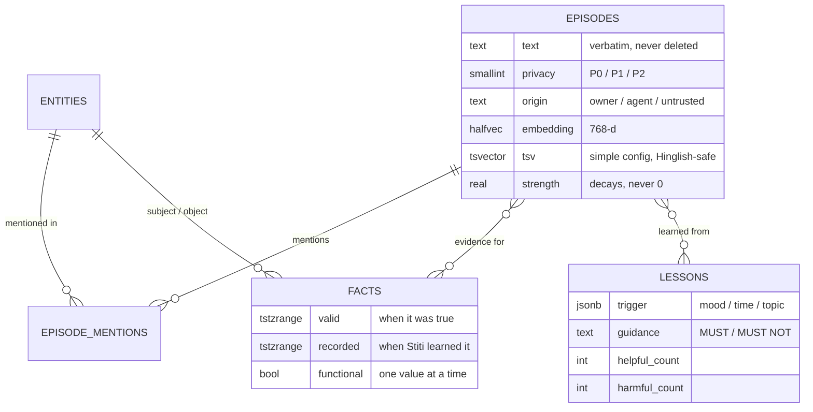

<div align="center">

```
   ███████╗████████╗██╗████████╗██╗
   ██╔════╝╚══██╔══╝██║╚══██╔══╝██║
   ███████╗   ██║   ██║   ██║   ██║
   ╚════██║   ██║   ██║   ██║   ██║
   ███████║   ██║   ██║   ██║   ██║
   ╚══════╝   ╚═╝   ╚═╝   ╚═╝   ╚═╝
```

### *Your girlfriend may not understand you, but Stiti will.*
**A local-first, zero-cost, Jarvis-style personal AI whose brain is memory, not an LLM.**


-lightgrey)


 

*"Hey Stiti" · "Wake up baby girl" — and she remembers everything.*

</div>

---

## 🧠 The idea in one line

> **Swap the LLM, and Stiti is still Stiti.**

Most AI assistants *are* their LLM: the model owns the personality, the context, the memory.
Stiti flips that. Her identity, memories, life graph, and learned lessons live in **her own
local Postgres brain**. Any free cloud LLM is just a **plug-in mouth** that reads a short
briefing Stiti compiles for each moment and turns it into words.

```
            ┌───────────────────────────── STITI (the brain, on your Mac) ─────────────────────────────┐
  you  ───► │ decide (System 1) → fast path (no LLM) │ recall → briefing → any free LLM → reply → learn │ ───► you
            └──────────────────────────────────────────────────────────────────────────────────────────┘
                           memory never leaves · identity never resets · model is replaceable
```

No fine-tuning. No vendor memory. No GPU. No bill.

---

## ✨ What she does (today)

| | Capability | How |
|---|---|---|
| 🗂️ | **Infinite memory** | Every word is stored verbatim forever. Hybrid vector + keyword recall with a 30-day fade that never hits zero. |
| 🕸️ | **Life knowledge graph** | People, projects, places, and feelings as **bitemporal facts**: "lived in Pune *until* Oct, Mumbai *since*". Postgres itself blocks two contradictory "current" facts. |
| 🎓 | **Learns from corrections** | Say *"itna lamba mat bolo"* once → it becomes a rule (lesson) checked before every reply in that situation. |
| ✅ | **Todos, alarms, reminders, timers** | *"kal subah 6 baje uthana"*, *"remind me at 7 pm to call mummy"*: handled **without any LLM** in ~30 ms, with the exact date read back. |
| 💛 | **Emotion-aware** | Fused mood signal with your personal baseline. It's a *hint*, never a verdict: Stiti asks, she doesn't declare. Voice emotion lands with the voice pipeline. |
| 🧘 | **Psychology built in** | At most 3 items per answer (cognitive load), no guilt words, a "minimum viable day" mode when you're drained, and WOOP goal-setting. |
| 🔒 | **Privacy tiers** | P0 public · P1 personal · **P2 sensitive (money, health, passwords) never leaves your Mac.** |
| 🌙 | **Sleeps like a brain** | A nightly job turns the day's chats into facts, updates your profile, curates lessons, and writes `USER.md`, `LESSONS.md` and `GRAPH_REPORT.md`. |
| 🎙️ | **Always-on voice** | Say **"Hey Stiti"**, **"Stiti"** or **"Wake up baby girl"** → chime → talk. "So jao" sends her to sleep. ~0.7–1.8 s from your last word to her voice on an M2. |
| 📅 | **Plans your day** | "plan my day" → OR-Tools CP-SAT time-blocks your tasks around deadlines and morning energy in ~50 ms. |
| 🌱 | **Habits without guilt** | Strength that grows and dents, never resets. Reminders fade as the habit sticks. |
| 🪜 | **Breaks big goals down** | "break down: launch Stiti" → Socratic questions → one 25-minute step with an if-then plan. |
| 🕸️ | **See your life graph** | `stiti graph` opens an interactive map of your people, projects and places. |
| 🔇 | **Talks over you? Never.** | WebRTC AEC3 echo cancellation: on laptop speakers the mic heard her own voice as speech 84% of the time, now 0%. Interrupt her anytime, no headphones. |
| 🎭 | **Hears how you feel** | emotion2vec+ base (70–165 ms, in the background) + pitch/loudness/pace vs. *your* normal voice + your words. |
| 📚 | **Reads your docs** | `stiti ingest ~/Notes` → PDFs, Word, slides, sheets and Markdown become searchable memory (~12 ms). Bank/medical folders stay P2. |
| 📆 | **Calendar & Reminders** | Apple Calendar (incl. Google calendars added to macOS) for "what's on today" and planning; every alarm is mirrored to Reminders so **it rings on your iPhone** even if the Mac is off. |
| 📬 | **Mail (read-only)** | Gmail via IMAP app password: "koi mail aaya?" Mail content is treated as untrusted: it can never make Stiti act. |
| 📱 | **Telegram** | Chat with Stiti from your phone; alarms get pushed there too. Owner-locked with a pairing code. |
| 🔌 | **Any MCP tool** | Plug in MCP servers; only the 5 most relevant tools are shown per request, write actions need your "haan", and a server whose tools change is disabled until you re-approve it. |
| 🤫 | **Knows when to shut up** | "shut up", "okay", "chalo", "bye", "bas" → she stops mid-sentence and stays silent (nudges too) until "Hi Stiti". |
| 👂 | **Lets you finish** | Smart Turn v3.2 tells a pause from a finished thought (6/6 in tests, ~30 ms); "haan/hmm" while she talks doesn't stop her. |
| 🔔 | **Speaks first — rarely** | Meeting in 10 min, a deadline, 3 h without a break, "how did the interview go?" — budgeted, quiet at night, and it learns which nudges you like. |
| 🖱️ | **Does things on your Mac** | Calendar events, Spotlight file search, music, iMessage (only after your "haan"), web search, "what's on my screen". |
| 📈 | **Gets better every day** | "nahi, galat" undoes and learns; "short mein" twice becomes a rule; lessons that keep failing retire themselves. |
| 🖥️ | **Lives in your menubar** | `stiti install-app` → signed Stiti.app, starts at login: ○ listening · ◉ awake · ⏸ muted. |
| 💾 | **Never loses her mind** | Nightly AES-256 encrypted backup of the whole brain (key in your Keychain); restores go into a separate database, never over the live one. |
| 👋 | **Gets to know you** | "intro shuru karo" → a 10-question interview that writes your people, routine, goals and how to talk to you straight into her brain. |
| ✍️ | **You can edit her mind** | Change, delete or add lines in `USER.md` / `LESSONS.md`; your edits flow back into Postgres and always win. |
| 🛟 | **Works offline** | No API keys or rate-limited? Todos, alarms, memory and lessons still work. Only deep conversation pauses. |

---

## 🗣️ A real session (engine v0, zero API keys)

```text
> Meri sister Priya Pune mein rehti hai, yaad rakhna
Stiti: Yaad rakh liya. 👍
> add todo buy milk
Stiti: Added: “buy milk”. (task #1)
> kal subah 7 baje alarm laga do
Stiti: Alarm set for tomorrow, Wed 11 Nov at 7:00 AM. (#3)
> where does my sister live
Stiti: …Here's what I remember from 10 Nov: “Meri sister Priya Pune mein rehti hai”
> itna lamba mat bolo yaar
Stiti: Samajh gaya — dhyan rakhunga. (lesson L1)
> mera bank password kya tha
Stiti: That sounds private, so I'm keeping it on this Mac.
```

---

## 🏗️ Architecture



### The memory model



---

## 📊 Measured on a base MacBook Pro M2 · 8 GB

Real numbers from this repo's evals, not marketing:

| What | Result |
|---|---|
| Memory recall (20 Hinglish/English memories, 10 questions) | **10/10** in top-3 (all rank 1) · **~10 ms** embed + recall |
| Embedder (EmbeddingGemma-300M, 4-bit ONNX) | **7 ms**/query · ~600 MB RSS |
| Intent decision: exemplar kNN | **26/30** · **8 ms** · ~0 extra RAM |
| Intent decision: Laya zero-shot (for comparison) | 13–15/30 · 203–514 ms · 2.7–2.9 GB |
| Fast-path turn (todo / alarm / lesson) | **~30–60 ms** end to end |
| Hinglish time parsing | **15/15** checks, including the 1 AM "kal" trap |
| Speech-to-text (whisper-small 4-bit) vs large-v3-turbo | **283 ms** vs 1,064 ms per utterance, ~same Hinglish accuracy |
| Your last word → Stiti's first audio (voice e2e, fast path) | **~0.7–1.8 s** |
| Whole voice stack + brain resident memory | **~954 MB** (+~800 MB with emotion2vec+), budget 3 GB |
| Echo: mic hearing her own voice as speech (laptop speakers) | **84% → 0%** with AEC |
| Document search (hybrid, chunks) | **~12 ms** |
| Memory eval (LongMemEval-style: extraction, multi-session, temporal, updates, abstention) | **12/12** |
| Smart Turn end-of-turn (finished vs. unfinished) | **6/6**, ~30 ms |
| Whole menubar app, measured with `footprint` | 2.76 GB → **1.25 GB** after capping MLX's cache (emotion2vec+ optional, +1.5 GB) |
| CP-SAT day plan, 8 tasks with deadlines | **45–64 ms**, all scheduled |
| Day scheduling, OR-Tools CP-SAT (researched) | 12 tasks solved optimally in 10–60 ms; 100 tasks ≈ 113 MB |

Run them yourself: `tests/recall_eval.py`, `tests/dates_eval.py`, `tests/laya_pilot.py`.

---

## 🔬 Built on research, not vibes

Before a single line of code, 6 parallel research tracks compared **at least 10 papers and
architectures per feature**: 300+ sources across assistants, memory, voice, psychology,
routing and connectors. Then [`rea`](https://github.com/morluto/rea) reverse-engineered
OpenClaw's memory pipeline.

📄 **[Full report (14k words)](<reports/Stiti personal AI buddy research.md>)** · 🗒️ [raw notes](research_notes/) · ⚖️ [decision log](docs/DECISIONS.md)

<details>
<summary><b>What Stiti borrows, and from whom</b></summary>

| Idea | From |
|---|---|
| Bitemporal facts that close instead of delete | Zep / **Graphiti** |
| Itemized lesson playbook updated by deltas | **ACE** (ICLR 2026), ExpeL |
| Provenance tags, nightly-only long-term writes, anti-nag standing intents | **OpenClaw** (reverse-engineered with rea) |
| Learning loop outside the model | **Hermes Agent** |
| Learn a rule only after 2 sightings at ≥0.72 confidence | **Leon** |
| Briefing as a compact graph report | **graphify** |
| Memory stream: recency × importance × relevance | **Generative Agents** |
| Sleep-time consolidation | **Letta** |
| Strength that decays but never deletes | **MemoryBank** |
| ≤3 items per spoken turn | Cognitive Load Theory |
| Anti-guilt wording, fresh starts | Self-compassion research (Wohl 2010; Breines & Chen 2012) |
| WOOP goal flow | Oettingen (g ≈ 0.34) |
| Habits as strength, not spaced repetition | Lally 2010 · Loop Habit Tracker |

</details>

<details>
<summary><b>Things the research killed</b></summary>

- ❌ **Local LLM / Ollama**: an 8 GB Mac can't hold a voice stack and a useful model. Thinking goes to free cloud tiers.
- ❌ **LiteLLM**: its PyPI package was compromised by a credential stealer on 2026-03-24. Stiti uses a ~150-line router instead.
- ❌ **ChromaDB**: pgvector in the same Postgres does it with joins.
- ❌ **SM-2 for habits**: spaced repetition spreads practice out, but habits need steady cue-linked repetition.
- ❌ **SenseVoice / Parakeet** for speech-to-text: neither hears Hindi. Whisper-family only.
- ⏸️ **Laya on the hot path**: measured at 2.7 GB and 200 ms on M2. Parked until an INT8 export and calibration land.

</details>

---

## 🚀 Quickstart

```bash
# 1. Brain store
brew install postgresql@18 pgvector && brew services start postgresql@18
createdb stiti && psql stiti -f db/schema.sql

# 2. Engine
uv sync

# 3. Free API keys (no card): Groq, Cerebras, OpenRouter
cp .env.example .env   # paste keys

# 4. Talk
uv run stiti doctor          # checks Postgres, embedder, keys, LLM
uv run stiti chat --debug    # chat; /debug shows route, mood, latency
uv run stiti voice           # always-on voice: "Hey Stiti" / "Wake up baby girl"
uv run stiti graph           # open your life graph
uv run stiti ingest ~/Notes  # make your notes/PDFs/docs searchable memory
uv run stiti onboard         # 3-minute intro so she knows who you are
uv run stiti backup          # encrypted backup now (also runs nightly); --show-key to save the key
uv run stiti install-app     # menubar app that starts at login (mic, Calendar, Reminders prompts say "Stiti")
uv run stiti sleep --now     # run the night job now
uv run stiti web             # Stiti in your browser: landing page + chat (127.0.0.1:7317)
uv run stiti teach           # whiteboard lesson by voice (built-in "How a compiler works"; no key needed)
uv run stiti teach book.pdf --chapter 3.1   # teach a book chapter (needs a free LLM key)
uv run stiti book book.pdf   # show a book's outline (works on scanned PDFs via the printed Contents)
```

Personal data lives in Postgres and `~/.stiti/` (`SOUL.md`, `USER.md`, `LESSONS.md`, `GRAPH_REPORT.md`), **never in git**.
`SOUL.md` is Stiti's personality. It's yours to edit.

---

## 🗺️ Roadmap

- [x] **Research**: 6 domains, ≥10 papers/architectures per feature, rea reverse-engineering
- [x] **Brain**: Postgres memory (episodes ∞, bitemporal facts, lessons, directives), hybrid recall, context compiler, free-cloud router, privacy tiers
- [x] **Knows you**: onboarding interview · editable `USER.md` / `LESSONS.md` (your edits win) · encrypted nightly backups
- [x] **Voice**: wake phrases · stop words ("shut up", "okay", "chalo", "bye") · Smart Turn end-of-turn · WebRTC echo cancellation + barge-in · "hmm…" filler · resumes after "haan"
- [x] **Emotion**: prosody vs. your baseline + text mood (+ optional emotion2vec+)
- [x] **Proactive**: meeting heads-ups · deadlines · break nudges · evening wrap-up · follow-ups ("how did the interview go?") · learned nudge gate
- [x] **Life OS**: CP-SAT day planner · Socratic goal chunker · forgiving habits · morning brief
- [x] **Mac actions**: Calendar read/write · Reminders two-way · Spotlight files · music · iMessage (with confirmation) · web search/read · screen awareness · OCR
- [x] **Learning loops**: inferred lessons · lesson scoring + nightly curation · undo + "what did you mean?" · topic segments · reflections
- [x] **App**: menubar (type-to-Stiti, quick todo, mood timeline, live status) · starts at login · health check · log rotation
- [x] **Evals + CI**: dates 15/15 · recall 10/10 · LongMemEval-style 12/12 · sync · proactivity · learning — on every push
- [x] **Whiteboard tutor**: voice lesson on a live Excalidraw board · draws while she talks · "ruko / phir se / peeche / skip" · questions on a side board · checks with hints · revision cards · resume later — tutor eval 27/27
- [x] **Web app**: `stiti web` — chat with the same Stiti in the browser, todos + alarms panel, light theme — web eval 12/12
- [ ] **Needs API keys to verify**: LLM conversation, tool calling, nightly fact extraction, reflections
- [ ] **Needs your voice**: Hinglish STT A/B, wake-word false-wake rate, personal voice baseline
- [ ] Later: Laya INT8 on the hot path · Google Workspace write actions · speaker verification · streaming LLM→TTS

---

## 🧭 Ground rules ([CLAUDE.md](CLAUDE.md))

1. **The brain is not an LLM.** Memory, graph, lessons and decisions belong to Stiti.
2. **Free, forever.** Free tiers plus small local models only.
3. **Local-first.** Your life stays on your Mac. Only a minimal briefing goes to the cloud, and P2 never does.
4. **Fast, for every feature.** Under 100 ms for the brain, under 1 s for voice.
5. **Research first.** At least 10 papers or architectures per feature before deciding.

---

## 📁 Repo map

```
src/stiti/
├── engine.py          # turn(): decide → fast path | recall → brief → LLM → lint → log
├── decide.py          # System 1: exemplar kNN / Laya + privacy & correction floors
├── intent.py          # exemplar classifier on the shared embedder
├── embed.py           # EmbeddingGemma 4-bit ONNX
├── router.py          # free-tier LLM chain, quotas, cooldowns, privacy gate
├── brain/
│   ├── memory.py      # episodes, hybrid recall, entity seeding
│   ├── compiler.py    # the briefing every LLM gets
│   ├── lessons.py     # learn-from-correction playbook
│   ├── emotion.py     # fused mood hint + baseline
│   ├── psych.py       # cognitive load, anti-guilt, WOOP, minimum viable day
│   └── sleep.py       # nightly consolidation → facts, USER.md, GRAPH_REPORT.md
├── fastpath/          # todos, alarms, reminders, timers, Hinglish dates
├── life/              # CP-SAT planner, habits, Socratic chunker, morning brief + Nudge Gate
├── voice/             # AEC duplex audio, VAD, whisper, Kokoro, wake phrases, prosody, emotion2vec+
├── connectors/        # EventKit (calendar, reminders), IMAP mail, Telegram
├── tools/             # tool registry (risk tiers, taint), MCP bus (pin-and-diff)
├── app.py             # menubar app · install_app.py builds Stiti.app + login agent
db/schema.sql          # 14 tables + recall() + current_facts()
docs/ · reports/ · research_notes/ · tests/
```

<div align="center">

---

*Built at 2 AM on an 8 GB MacBook, for ₹0.*
**Stiti: memory is the mind; the model is just the voice.**

</div>
